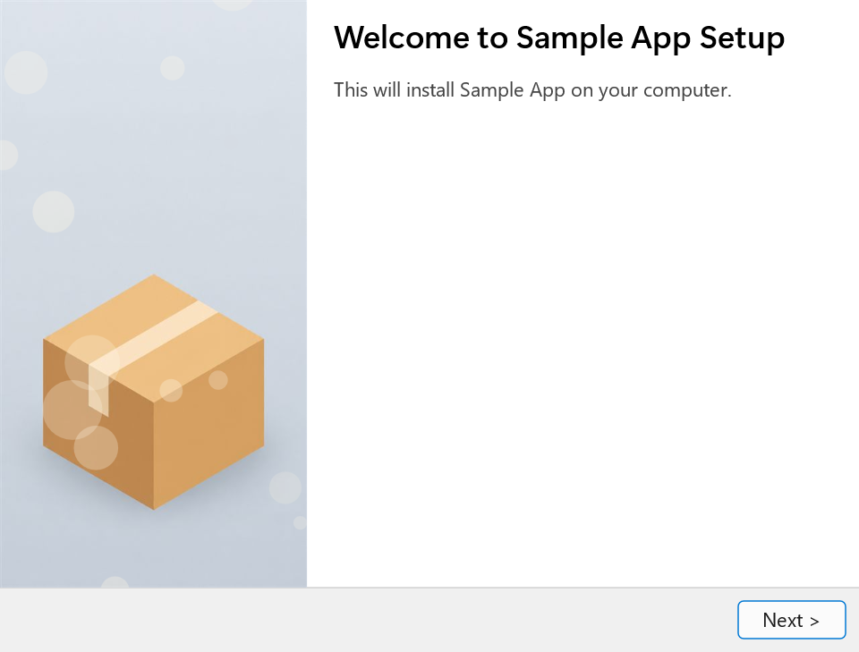

# Small Installer

**Modern looks. Tiny installers.**

Build a modern, compact Windows installer with help from your LLM. Small Installer is a header-only C11 library that bundles your application and uninstaller into one setup executable, with no separate C runtime installation required.

[Get started](#get-started) · [Sample app](examples/sample-app) · [Developer reference](docs/reference.md) · [MIT license](LICENSE)

Used by [Termy](https://termy.ai).

## Why Small Installer?

- **Describe it to your LLM.** It's faster and easier than using a visual designer. The configuration stays in ordinary C code you can review and keep alongside your app.
- **Make it look like your app.** Use your own icon, welcome image and accent color, with optional dark mode and page transitions. [Slim UI](https://github.com/live-sound/slim-ui) draws the wizard with Direct2D and DirectWrite.
- **Extremely compact.** A minimal three-page installer measures about **116 KiB**, or **161 KiB with an uninstaller**. Your application files add their LZMA-compressed size on top. See the [build conditions and measurements](docs/reference.md#size).
- **Speak your users' language.** The wizard follows the Windows locale, and the sample includes translations in 30 languages.
- **Handle the Windows essentials.** Configure shortcuts, registry entries, URL protocol handlers, per-user or administrator installation, and reinstall options. Silent installs, updates and uninstalls are supported too.
- **Extend the wizard.** Add custom pages, callbacks or downloads during installation.



## Get started

The sample includes a working application, installer and uninstaller. Use it as the starting point for your own setup program.

You'll need **Windows**, **Visual Studio 2022 with the C++ desktop tools and Windows SDK**, **CMake 3.23 or newer**, and **Git**. Run these commands in PowerShell:

```powershell
git clone --recursive https://github.com/live-sound/small-installer.git
cd small-installer
```

Already cloned the repository? Run `git submodule update --init --recursive` to fetch Slim UI before building.

### Make it yours

Open the repository in your LLM coding tool and tell it where to find your application files and artwork. For example:

> Adapt examples/sample-app into a per-user installer for MyApp. Use a blue accent, a license page and a Start Menu shortcut. Offer to launch the app when setup finishes. Include an uninstaller and update the build script to pack my application files. Ask me for any missing app details or file locations.

Review the changes before building. If you'd like to edit the configuration yourself, see the [sample app guide](examples/sample-app/README.md) or the [C configuration example](docs/reference.md#configure-your-installer).

### Build and try it

From the repository folder, run:

```powershell
.\examples\sample-app\build.ps1
```

The script builds and packs the installer, then prints the output path. Without any changes, it produces **`build\SampleAppSetup.exe`**. Run the setup program to check the pages and installation behavior, then ask your LLM for any adjustments.

## Updates and unattended installs

Small Installer detects an existing installation using your app's `app_id`. Keep that identifier stable across releases so updates find the right installation.

```powershell
.\MyAppSetup.exe --silent
.\MyAppSetup.exe --silent --launch
.\MyAppSetup.exe --silent-update
```

`--silent` installs without a window; `--launch` starts the app after success. `--silent-update` installs and then relaunches the app. The uninstaller also accepts `--silent` and keeps application data. See the [command-line reference](docs/reference.md#command-line) for details.

Setup terminates running processes matching the configured app executable name before replacing files. If a file remains locked, interactive setup offers Retry or Cancel; silent setup fails with a nonzero exit code. See [replacement behavior](docs/reference.md#replacing-an-existing-installation) when planning your update flow.

## Explore further

| I want to… | Start here |
|------------|------------|
| Adapt a working installer | [Sample app guide](examples/sample-app/README.md) |
| Choose pages and configure the wizard | [API reference](docs/reference.md#api-reference) |
| Add languages | [Internationalization](docs/reference.md#internationalization) |
| Bundle files into the setup program | [si_pack](docs/reference.md#si_pack-tool) |
| Understand the internals | [Architecture](docs/reference.md#architecture) |

## License

[MIT](LICENSE), including the sample application, images and locale files. Small Installer uses [Slim UI](https://github.com/live-sound/slim-ui) (MIT) and the LZMA SDK (public domain).
