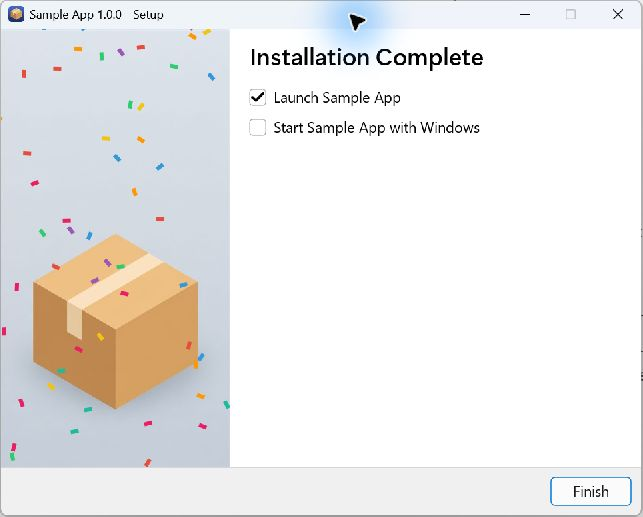

# Small Installer

**A small installer. A polished welcome to your Windows app.**

Small Installer is a header-only C11 library for building Windows installers and uninstallers. Configure your wizard in C, bundle your app into a single executable, and ship without requiring a separate C runtime installation.

[Get started](#get-started) · [Sample app](examples/sample-app) · [Developer reference](docs/reference.md) · [MIT license](LICENSE)



Used by [Termy](https://termy.ai).

## What you can build

- **Describe it to your LLM.** Tell it which pages, branding, shortcuts and install behavior you need, and have it adapt the sample app. A small C configuration makes it easy to review the result and ask for changes.
- **A wizard that feels like your app.** Add your icon, welcome image and accent color, with optional dark mode and page transitions. Rendering comes from [Slim UI](https://github.com/live-sound/slim-ui), using Direct2D and DirectWrite.
- **A compact, self-contained download.** LZMA compression packs your application and uninstaller into one setup executable. `MinSizeRel` builds use the library's no-CRT mode.
- **An installation in your users' language.** The wizard follows the Windows locale. The sample includes translations in 30 languages.
- **The Windows essentials.** Configure shortcuts, registry entries, URL protocol handlers, per-user or administrator installation, and reinstall options.
- **Room for your own flow.** Add custom pages, callbacks and optional downloads, or run installs, updates and uninstalls silently.

## Get started

The quickest way to try Small Installer is to build the sample. It includes a tiny application, a complete installer and uninstaller, images, and translations.

You'll need **Windows**, **Visual Studio 2022 with the C++ desktop tools and Windows SDK**, **CMake 3.23 or newer**, and **Git**. Run these commands in PowerShell:

```powershell
git clone --recursive https://github.com/live-sound/small-installer.git
cd small-installer
.\examples\sample-app\build.ps1
```

Your setup program is ready at **`build\SampleAppSetup.exe`**. Run it to try the wizard.

Already cloned the repository? Run `git submodule update --init --recursive` to fetch Slim UI before building.

### Make it yours

Start with the [sample app guide](examples/sample-app/README.md). It walks through changing the app name and identity, adding your artwork and license, and packing your application files.

### Configure your installer

This is a minimal three-page wizard: choose a folder, install, and finish. Save it as `installer.c` in your project and replace the example values, including `app_id` with a GUID unique to your application.

```c
#define SI_FEATURE_D2D
#define SI_MODE_INSTALL
#define SI_IMPLEMENTATION
#include <small_installer/small_installer.h>

int si_main(HINSTANCE hInst) {
    SiConfig cfg = {0};
    cfg.name         = L"MyApp";
    cfg.version      = L"1.0.0";
    cfg.publisher    = L"My Company";
    cfg.app_id       = L"{YOUR-GUID-HERE}";
    cfg.exe          = L"MyApp.exe";
    cfg.install_base = SI_PATH_LOCAL_APP_DATA;
    cfg.install_sub  = L"MyApp";
    cfg.privileges   = SI_PRIV_PER_USER;
    cfg.accent_color = 0x2196F3;

    cfg.pages[0] = si_page_install_dir();
    cfg.pages[1] = si_page_installing();
    cfg.pages[2] = si_page_finished(NULL, 0);
    cfg.page_count = 3;

    return si_run(&cfg, hInst);
}
```

Define `SI_IMPLEMENTATION` in exactly one C file per executable. The library calls `si_main()` from its entry point; your function configures the wizard and runs it. The [configuration reference](docs/reference.md#siconfig) covers the other options.

### Build and pack

With this repository in a `small-installer` subfolder, add it to your CMake project:

```cmake
set(SI_BUILD_EXAMPLES OFF)
add_subdirectory(small-installer)
si_add_wizard(MySetup installer.c installer.rc)
si_add_wizard(MyUninstall uninstaller.c uninstaller.rc)
```

Use the sample's [resource file](examples/sample-app/installer.rc), [manifest](examples/sample-app/wizard.manifest), and [uninstaller](examples/sample-app/uninstaller.c) as starting points for the files above. `si_add_wizard` supplies the include paths, libraries and build flags. If you already have a Slim UI checkout, set `SI_SLIM_UI_DIR` to its path.

Build from your project folder:

```powershell
cmake -B build -G "Visual Studio 17 2022" -A x64
cmake --build build --config MinSizeRel
```

The build produces the wizard executables and `si_pack`, the packaging tool. **Pack your application files before distributing the installer.** The sample's [build script](examples/sample-app/build.ps1) shows the full sequence: pack the uninstaller first, then bundle it with your app into the installer. See [packaging options](docs/reference.md#si_pack-tool) for individual commands.

Use `Release` for a build with the C runtime, or `MinSizeRel` for distribution with the no-CRT configuration. For size breakdowns and tradeoffs, see the [size measurements](docs/reference.md#size).

## Updates and unattended installs

Small Installer detects an existing installation using your app's `app_id`. Keep that identifier stable across releases so updates find the right installation.

```powershell
.\MyAppSetup.exe --silent
.\MyAppSetup.exe --silent --launch
.\MyAppSetup.exe --silent-update
```

`--silent` installs without a window; `--launch` starts the app after success. `--silent-update` installs and then relaunches the app. The uninstaller also accepts `--silent` and keeps application data. See the [command-line reference](docs/reference.md#command-line) for details.

Setup terminates running processes matching the configured app executable name before replacing files. If a file remains locked, interactive setup offers Retry or Cancel; silent setup fails with a nonzero exit code. See [replacement behavior](docs/reference.md#replacing-an-existing-installation) when planning your update flow.

## Why no visual designer?

Because it's faster and easier to tell your LLM what you need. Describe your installer—its pages, branding, shortcuts and install behavior—and let it adapt the [sample app](examples/sample-app/README.md) for you.

For example: “Make a per-user installer for MyApp with a blue accent, a license page and a Start Menu shortcut. Offer to launch the app when setup finishes.” The result is ordinary C code you can review, build and try. Further changes start with another request.

## Explore further

| I want to… | Start here |
|------------|------------|
| Adapt a working installer | [Sample app guide](examples/sample-app/README.md) |
| Choose pages and configure the wizard | [API reference](docs/reference.md#api-reference) |
| Add languages | [Internationalization](docs/reference.md#internationalization) |
| Bundle files into the setup program | [si_pack](docs/reference.md#si_pack-tool) |
| Understand the internals | [Architecture](docs/reference.md#architecture) |

To build and run the repository's tests after configuring it with CMake:

```powershell
cmake --build build --config MinSizeRel
ctest --test-dir build -C MinSizeRel --output-on-failure
```

## License

[MIT](LICENSE), including the sample application, images and locale files. Small Installer uses [Slim UI](https://github.com/live-sound/slim-ui) (MIT) and the LZMA SDK (public domain).
